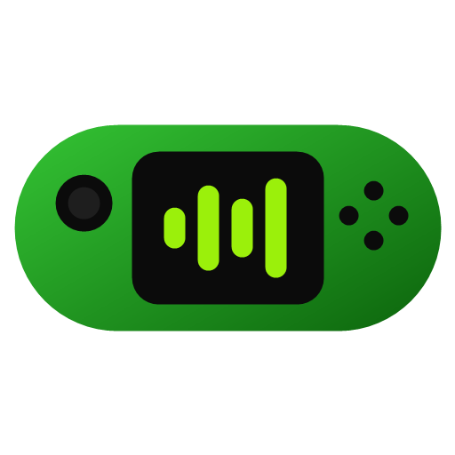
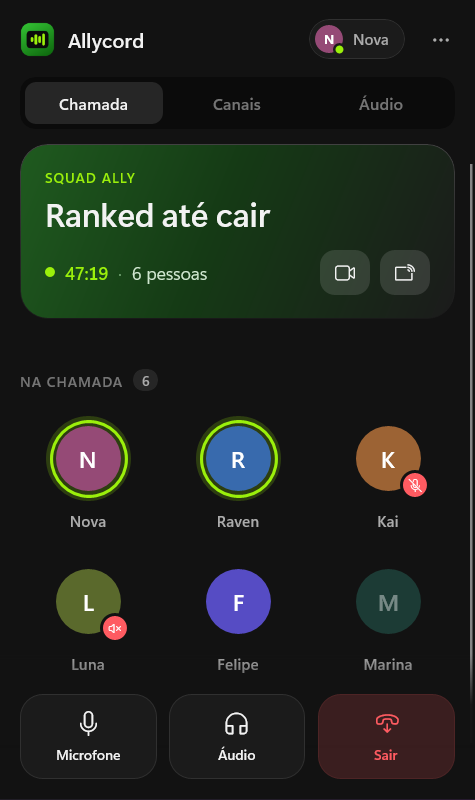
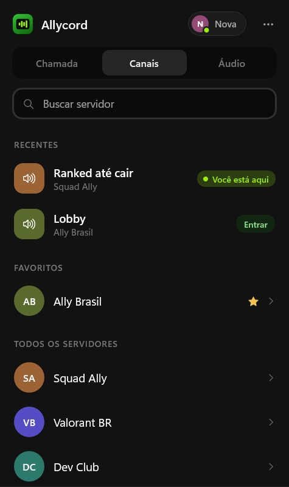
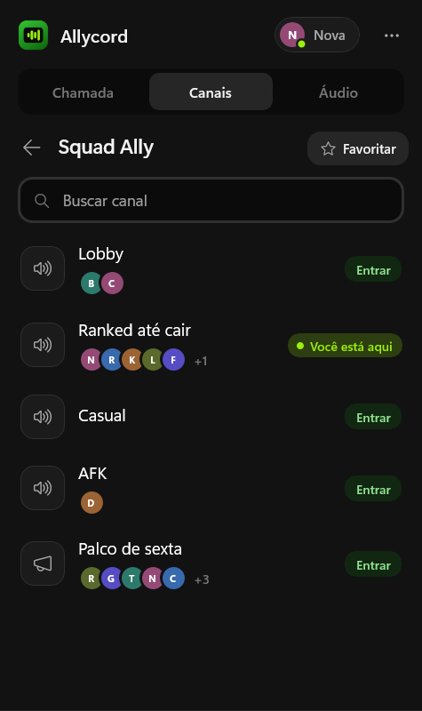
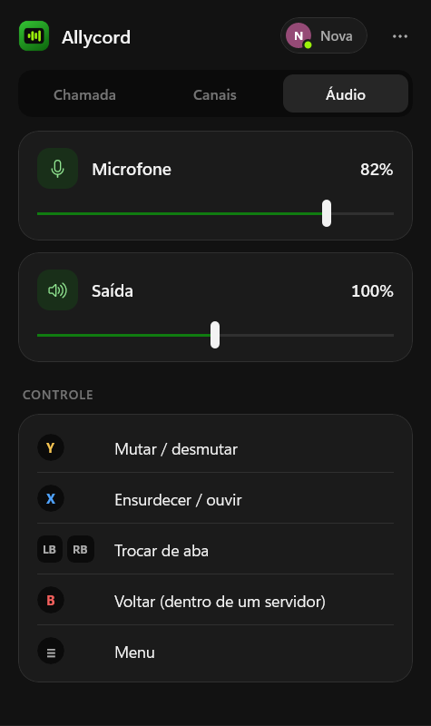
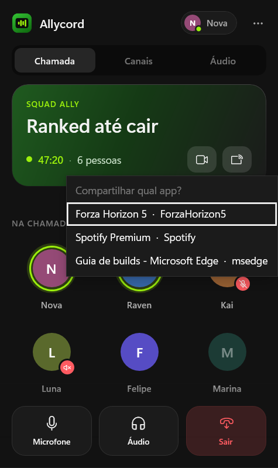
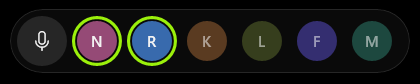
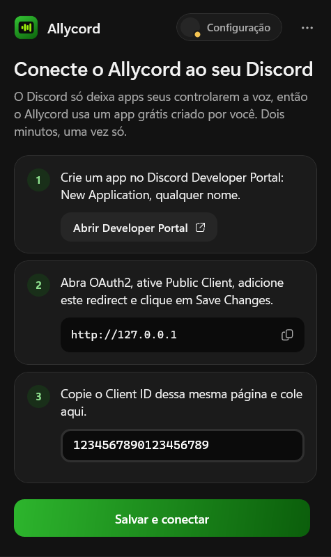

<p align="center">
  
</p>

<h1 align="center">Allycord</h1>

<p align="center">
  <b>Discord voice controls inside Xbox Game Bar.</b><br>
  Built for the ROG Xbox Ally / Ally X — works on any Windows handheld or PC.
</p>

<p align="center">
  <a href="#english">English</a> · <a href="#português">Português</a>
</p>

<p align="center">
  
  
  
</p>

---

## English

Mute, deafen, see who's talking and hop between voice channels — without alt-tabbing out of your game.
Press the Xbox button, and it's there. Sister project of [Discord-Lite](https://github.com/lopesleo/Discord-Lite) for Steam Deck.

### Features

- **Call** — mute, deafen, leave (with a one-tap *Rejoin* if you hit it by mistake), live call timer.
- **Who's talking** — everyone in the channel, with a speaking ring and mute/deafen badges.
- **Camera and screen share** (pick which app to share), shown only when your Discord offers them over RPC. Where Discord has Go Live
  disabled (e.g. Brazil, by regulatory order) Allycord tells you and hides the button — it never works around it.
- **Per-person volume** and *mute for me* (tap a person).
- **Channels** — recent channels (one tap to rejoin), favorite servers, search, and a preview of who's in each voice channel.
- **Audio** — microphone and output volume.
- **Pinned overlay** — pin the widget and, with Game Bar closed, a small pill over your game shows who's speaking.
- **Controller first** — `Y` mute · `X` deafen · `LB`/`RB` switch tabs · `B` back · `≡` menu.
- English and Portuguese.

<p align="center">
  
  
</p>
<p align="center">
  
</p>

### Light on purpose

A handheld has no resources to spare, so Allycord stays out of the game's way: no looping animations, images
decoded at display size, rarely used screens built only when opened, and a helper that reacts to Discord
events instead of polling.

Measured on the Release build, connected and idle:

| Process | CPU (idle) | Private memory |
| --- | --- | --- |
| `Allycord.Bridge` (talks to Discord) | ~0% | ~10 MB |
| `Allycord.Widget` (the Game Bar UI) | ~0.01% | ~118 MB (Game Bar itself: ~90 MB) |

Discord itself must be running. If it's closed, **Open Discord** starts it minimized to the tray, so it doesn't draw a window.

### Requirements

- Windows 10 2004+ or Windows 11, x64
- Discord desktop app
- A Discord application of your own — free, two minutes, once (below)

### Install

1. Download `Allycord-<version>-x64.zip` from [Releases](../../releases) and extract it.
2. Right-click `Install.ps1` → **Run with PowerShell**. It asks for admin once to trust the package
   certificate, then installs Allycord and its dependencies.
3. Open Game Bar (`Win + G` or the Xbox button) → **Widgets** → **Allycord** → click the star to keep it in the menu.

### Set up your Discord app (once)



Discord's voice API (local RPC) is in private beta: it only works with Discord applications **you own**.
So Allycord runs on one you create — the app walks you through it:

1. Open the [Discord Developer Portal](https://discord.com/developers/applications) → **New Application** (any name).
2. In **OAuth2**: turn on **Public Client**, add the redirect `http://127.0.0.1`, **Save Changes**.
3. Copy the **Client ID**, paste it in Allycord → **Save and connect**.
4. Discord shows an authorization window → **Authorize**.

Use the Discord account that created the app. For a second account, create another app with it
(menu `⋯` → **Discord app**) or add it under **App Testers** in your app.

The Client ID is public by design; there is no secret involved (PKCE). Your token stays on your PC.

<br clear="right">

### Troubleshooting

| Message | Fix |
| --- | --- |
| *Discord didn't recognize this Client ID* | Copy the number under OAuth2 → Client ID (17–20 digits). |
| *Turn on Public Client* | OAuth2 → Public Client → on → Save Changes. |
| *Isn't the owner of the configured app* | Discord is logged into a different account than the one that created the app. |
| *Discord is closed* | Use **Open Discord**; the browser version of Discord doesn't expose RPC. |

Logs: `%LOCALAPPDATA%\Packages\lopesleo.Allycord_*\LocalState\bridge.log`

### How it works

Game Bar widgets are sandboxed UWP apps and can't open Discord's IPC pipe. Allycord ships a small
full-trust helper (`Allycord.Bridge`, .NET 9) in the same package: it talks to the Discord app over
`\\.\pipe\discord-ipc-0` and to the widget over an AppService. The only network call is the OAuth
token exchange with Discord. Details: [PLAN.md](PLAN.md).

### Build from source

Visual Studio 2022 or Build Tools with **Universal Windows Platform build tools**, Windows SDK
10.0.22621+, .NET 9 SDK, Developer Mode on.

```powershell
.\build.ps1             # Debug: build and register on this PC
.\build.ps1 -Release    # signed package + dist\Allycord-<version>-x64.zip
```

Design review without Discord: put a scene name (`call`, `channels`, `audio`, `setup`, `pinned`…) in
`LocalState\demo.txt` and launch Allycord from Start. `tools\make-logo.ps1` regenerates the icons.

---

## Português

Mute, ensurdeça, veja quem está falando e troque de canal de voz — sem sair do jogo.
Aperte o botão Xbox e está lá.

### O que faz

- **Chamada** — mutar, ensurdecer, sair (com *Voltar* se sair sem querer), timer da chamada.
- **Quem está falando** — todos no canal, com anel de fala e indicadores de mudo/surdo.
- **Câmera e compartilhamento de tela** (escolha qual app), só quando o seu Discord oferece pelo RPC. Onde o Discord desativou o Go Live
  (ex.: Brasil, por ordem da ANPD), o Allycord avisa e esconde o botão — nunca contorna o bloqueio.
- **Volume por pessoa** e *silenciar para mim* (toque na pessoa).
- **Canais** — recentes (um toque para voltar), servidores favoritos, busca e quem está em cada canal.
- **Áudio** — volume do microfone e da saída.
- **Overlay fixado** — com o widget fixado e o Game Bar fechado, uma pílula sobre o jogo mostra quem fala.
- **Feito para controle** — `Y` mutar · `X` ensurdecer · `LB`/`RB` trocar aba · `B` voltar · `≡` menu.

Leve de propósito: sem animações em loop, imagens no tamanho exibido e nada de polling. Medido em
Release, conectado e parado: bridge ~0% de CPU e ~10 MB; widget ~0,01% de CPU.

### Instalação

1. Baixe `Allycord-<versão>-x64.zip` em [Releases](../../releases) e extraia.
2. Clique com o botão direito em `Install.ps1` → **Executar com o PowerShell** (pede admin uma vez).
3. Game Bar (`Win + G` ou botão Xbox) → **Widgets** → **Allycord** → marque a estrela.

### Configure seu app do Discord (uma vez)

A API de voz do Discord está em beta fechado e só funciona com apps **seus**. O Allycord guia você:

1. [Discord Developer Portal](https://discord.com/developers/applications) → **New Application** (qualquer nome).
2. Em **OAuth2**: ative **Public Client**, adicione o redirect `http://127.0.0.1`, **Save Changes**.
3. Copie o **Client ID**, cole no Allycord → **Salvar e conectar**.
4. No Discord, clique em **Autorizar**.

Use a mesma conta que criou o app. O Client ID é público por natureza; não há segredo envolvido e o token fica no seu PC.

---

Allycord is not affiliated with or endorsed by Discord Inc., Microsoft or ASUS.
MIT licensed.
